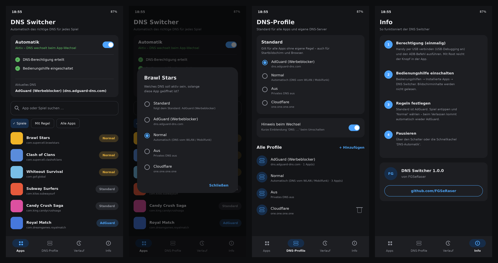
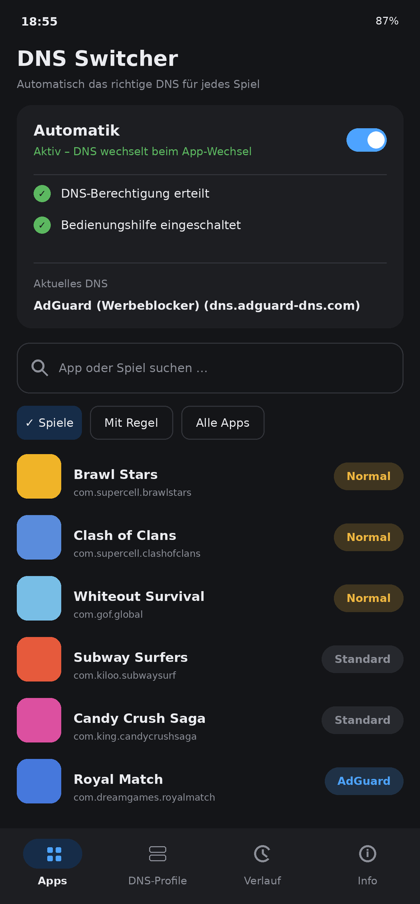
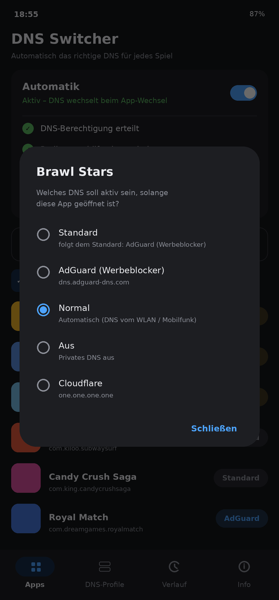
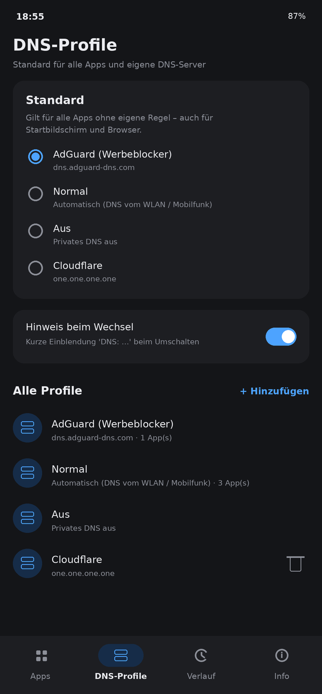
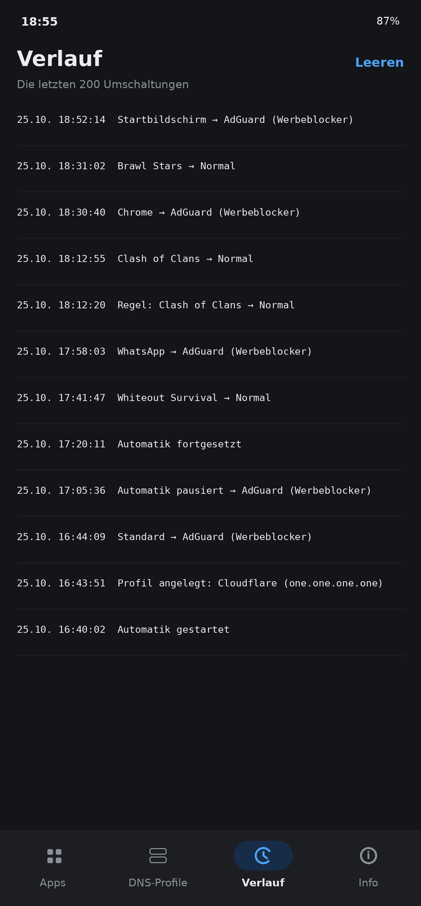
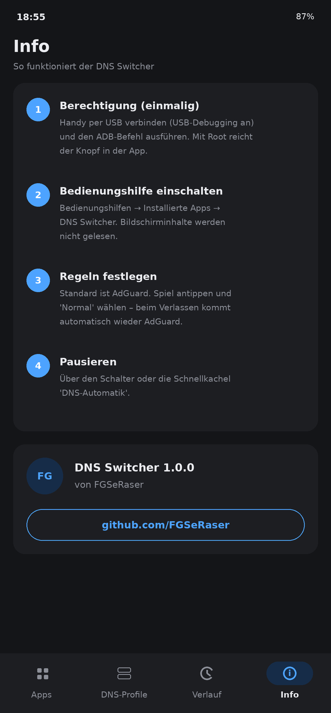

# DNS Switcher

Android-App, die das **private DNS automatisch umstellt**, je nachdem, welche App oder welches Spiel gerade offen ist.
Normalerweise ist **AdGuard** aktiv. Für ausgewählte Spiele schaltet die App auf **Normal** (Automatisch) und beim Verlassen wieder zurück.

Entwickelt von **FGSeRaser** – https://github.com/FGSeRaser


| Apps | Regel | Profile | Verlauf | Info |
|---|---|---|---|---|
|  |  |  |  |  |

## Bauen

1. Ordner in **Android Studio** öffnen (Ladybug oder neuer). Gradle und alle Abhängigkeiten werden automatisch geladen.
2. **Build → Build App Bundle(s) / APK(s) → Build APK(s)**, oder das Handy anschließen und ▶ drücken.
3. Mindestens Android 9, denn privates DNS gibt es erst ab Android 9.

## Einrichten (einmalig)

1. **Berechtigung erteilen.** Am einfachsten ohne PC mit **Shizuku**: Shizuku-App installieren, über „Kabelloses Debugging“ starten und in DNS Switcher auf **„Mit Shizuku“** tippen. Alternativ per ADB: Android lässt Apps das private DNS nur mit dieser Systemberechtigung ändern:
   ```
   adb shell pm grant de.fgseraser.dnsswitcher android.permission.WRITE_SECURE_SETTINGS
   ```
   Das geht auch über die ADB ToolBox → Konsole. Auf gerooteten Handys reicht der Knopf „Mit Root freischalten“ in der App. Die Berechtigung bleibt bestehen, auch nach einem Neustart oder App-Update.
2. **Bedienungshilfe einschalten:** Einstellungen → Bedienungshilfen → Installierte Apps → **DNS Switcher**.
   Ist der Schalter ausgegraut („Eingeschränkte Einstellung“), weil die APK nicht aus dem Play Store kommt: App-Info → ⋮ → **„Eingeschränkte Einstellungen zulassen“**. Wer die App per `adb install` installiert, hat dieses Problem nicht.
3. In der App ein Spiel antippen und **Normal** wählen. Fertig.

## Funktionen

- Liste aller Apps mit Suche und Filter (Spiele / Mit Regel / Alle). Spiele werden automatisch erkannt und markiert.
- Für jede App wählbar: Standard, AdGuard, Normal, Aus oder ein eigenes Profil.
- Der Standard für alle anderen Apps ist frei wählbar und steht ab Werk auf AdGuard.
- Eigene DNS-Profile mit Vorlagen: AdGuard Familie, AdGuard ungefiltert, Mullvad Werbeblocker, Cloudflare, Google, Quad9.
- Schnellkachel **„DNS-Automatik“** zum Pausieren. Pausiert bleibt der Standard aktiv.
- Kurze Einblendung beim Wechsel (abschaltbar) und ein Verlauf der letzten 200 Umschaltungen.
- Wenn die Bedienungshilfe ausgeschaltet wird, stellt die App wieder den Standard ein.

## Nerd-Dashboard

- **Schutz jetzt:** fragt live und ohne Cache über das System-DNS bekannte Werbe-Domains ab und zeigt, wie viel davon gerade blockiert wird. Dazu kommen die Antwortzeit und ob normale Seiten noch gehen.
- **Geblockt (AdGuard-Konto):** zeigt echte Zähler (Anfragen, geblockt, Verlauf, Top-Domains, Firmen, Kategorien) über die AdGuard-DNS-API, für 24 Std., 7 oder 30 Tage. Dafür brauchst du ein kostenloses AdGuard-DNS-Konto mit eigener Adresse (`xxxx.d.adguard-dns.com`) als Profil und einen API-Schlüssel. Ohne Konto kann keine App die Anfragen zählen, weil das private DNS im System läuft.
- **Deine Nutzung:** Wechsel pro Tag, Aktivität nach Uhrzeit, Zeit pro DNS-Profil, meistgenutzte Apps und der Anteil der Zeit mit Filter. Alles lokal.
- **DNS-Benchmark:** misst DNS-over-TLS direkt auf Port 853 für alle Profile plus Cloudflare. Angezeigt werden min/Ø/max, Jitter, TCP- und TLS-Zeit, TLS-Version, Cipher und Zertifikat.
- **Blockier-Test:** prüft 37 Werbe-, Tracker- und Spiele-Werbe-Domains gegen jeden Server. Die Quote gibt es pro Kategorie, Fehlblockierungen werden gewarnt, und eine Domain-Matrix zeigt jede Domain einzeln.
- **Netzwerk-Interna:** Netzart, Interface, aktiver DoT-Server, DNS-Server, IPv4/IPv6, MTU, Bandbreite.

Die **Update-Prüfung** im Info-Tab schaut auf GitHub nach einer neuen Version.

## Datenschutz

Die App liest keine Bildschirminhalte. Sie bekommt von Android nur den Paketnamen der App, die gerade in den Vordergrund kommt. Die Internet-Berechtigung braucht nur das Nerd-Dashboard: für DNS-Tests, die AdGuard-Statistik mit deinem eigenen Schlüssel und die Update-Prüfung bei GitHub. Die Nutzungsstatistik bleibt auf dem Handy.

## Tipps

- Hatte ein Spiel schon beim Start AdGuard aktiv (z. B. weil die Bedienungshilfe aus war), das Spiel einmal ganz schließen und neu öffnen.
- Samsung: Einstellungen → Apps → DNS Switcher → Akku → „Nicht eingeschränkt“, damit One UI die Bedienungshilfe nicht beendet.
